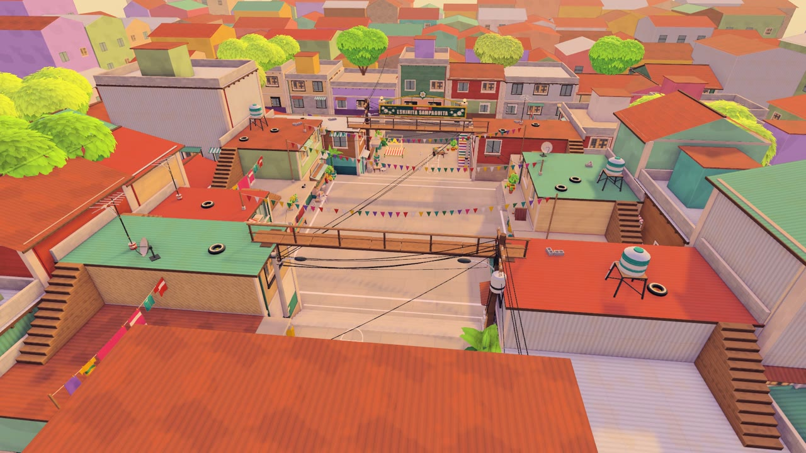

# Tumbang Preso

**BH Studios · DOST-NCR regional game development competition, 1st place**

A four-player adaptation of the Filipino street game. Three attackers throw their *tsinelas* (slippers) at a *lata* (tin can). The *taya* guards it. The throw creates an opening, but getting your slipper back is the dangerous part.

| For judges | Start here |
| --- | --- |
| Play from source | [Open in Unity and try a match](docs/PLAY.md) |
| Judge the design | [Rules, modes, and settings](docs/DESIGN.md) |
| Review the implementation | [Source map and validation](docs/UnityProjectContext.md) |
| See who made it | [Team and asset credits](docs/CREDITS.md) |

### Try this first

1. Open the project in **Unity 6000.5.8f1**, open [SplashScreen](Assets/TumbangPreso/Scenes/Ui/SplashScreen.unity), and press **Play**.
2. Continue as **Guest**, then choose **Gamemode → Practice → Tutorial** to learn both roles.
3. Try **Practice → Training** with active bots. For a four-person session on the same network, use **Gamemode → Custom → Host → LAN**.

**Classic** keeps the throwing, retrieval, and tagging game. **Hero Strike** uses the same objective and adds two skills and an ultimate per hero. The taya role rotates between players.

[University of the Philippines Manila competition announcement](https://dpsm.cas.upm.edu.ph/index.php/2026/09/09/bs-comsci-students-win-dost-ncr-regional-game-development-competition/)
