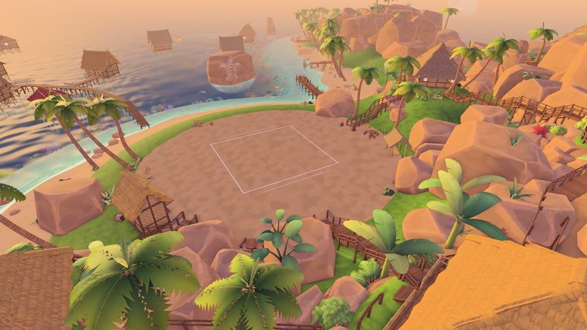
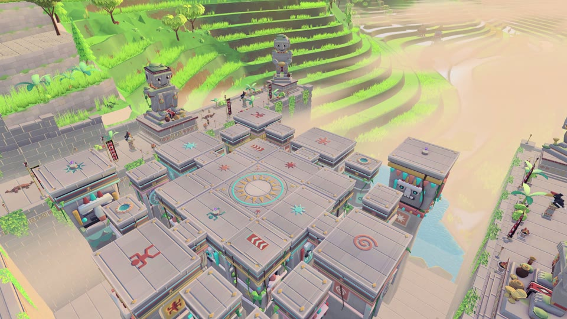

# Game design

## The chalk line changes the risk

An attacker has two decisions after a throw: when to enter the court, and which route to take back out. A downed lata gives the attackers time while the taya restores it. While the lata is standing, an attacker holding their slipper inside the danger area can be tagged. The taya must decide when to guard the can and when to chase. The role rotates across all four seats, and score carries through the match.

| Ruleset | What to look for |
| --- | --- |
| **Classic** | Can aim, throw timing, routes through the court, and reading the taya. |
| **Hero Strike** | The same retrieval and defense decisions under pressure from hero abilities. Each hero has two skills and an ultimate. The kit changes how a player creates or closes an opening. |

A standard match has four seats and defaults to four rounds in both modes. See [Balance.cs](../Packages/com.tumbangpreso.core/Runtime/Balance.cs) and [CustomGame.cs](../Packages/com.tumbangpreso.core/Runtime/CustomGame.cs) for the active defaults and custom settings.

## Courts and presentation

Eskinita puts the game in a neighborhood lane. Lagoon Cove and Payo move it to a waterside community and terraced fields. The project also includes Ilalim ng Tulay, Kanto, and Arena. Explore a second court after Eskinita to see how the team carries the same throwing and retrieval rules into a different setting.

| Lagoon Cove | Payo |
| --- | --- |
|  |  |
